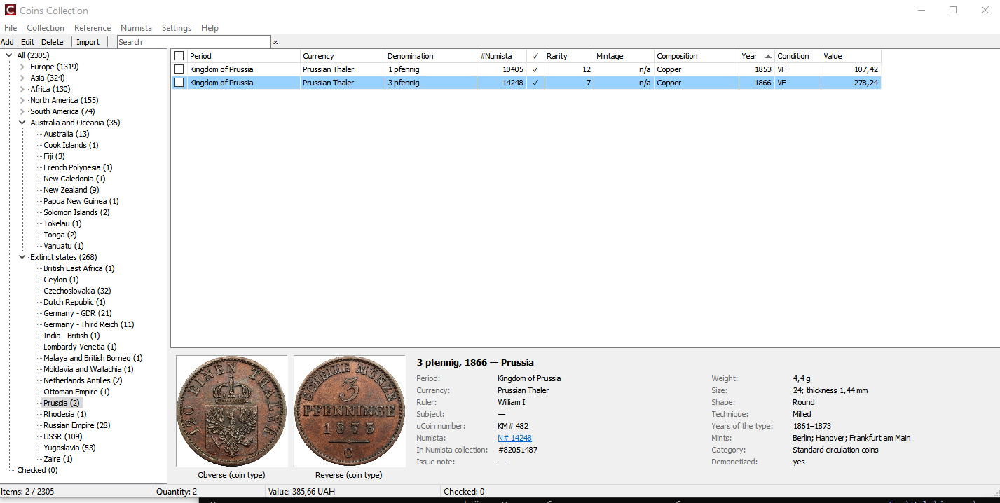

# Coins Collection

Your coin collection on your computer — and an easy way to move it from **uCoin** to **Numista**.

[**⬇ Download the latest version**](https://github.com/dimaburkov/CoinsCollection/releases/latest) · Windows 10 / 11 · free · [Українською](#українською)

## What it does

- **Imports your uCoin collection** from the uCoin export file (`.xlsx`) — countries, periods, denominations, years, conditions, prices, comments.
- **Finds every coin in the Numista catalogue** — by KM / Y / C number, year and your own search phrase; historical states (e.g. Polish–Lithuanian Commonwealth) included.
- **Adds the coins to your Numista collection** — condition, price, purchase date, comment; nothing is sent twice.
- **Loads catalogue data from Numista** — mintage, composition, weight, size, ruler, demonetization and the obverse / reverse pictures.
- **Imports coins you added on Numista yourself** (for example ancient coins that are not on uCoin), with year ranges and BC years.
- **Rarity index** — read from the private comment of your Numista items (`R:97` or simply `97`), sortable in the list.
- **Your own photos** of each coin, a photo viewer, search, filters, a tree of continents and countries.
- **Backup and restore** of the whole collection (database and photos) in one `.zip` file.
- English and Ukrainian interface, built-in help (F1).

## Installation

1. Download `CoinsCollection-Setup-<version>.exe` from [Releases](https://github.com/dimaburkov/CoinsCollection/releases/latest) and run it. Administrator rights are not needed.
2. The installer is not digitally signed, so Windows may warn you:
   - the browser: *“This file is not commonly downloaded”* → **Keep**;
   - Windows SmartScreen: **More info → Run anyway**.
3. The program is installed for the current user into `%LOCALAPPDATA%\Programs\CoinsCollection`. Your collection, photos and settings are kept in that folder; they stay there when you update or remove the program.

**Update:** install the new version over the old one — the collection stays, the database is upgraded automatically.

You can check the downloaded file with its SHA-256 checksum from the release page (PowerShell: `Get-FileHash .\CoinsCollection-Setup-0.2.0.exe`).

## First steps

1. **uCoin:** export your collection to Excel (`.xlsx`) and import it: **File → Import from uCoin (.xlsx)**.
2. **Numista:** register on [numista.com](https://en.numista.com/), get your free API key at [en.numista.com/api/api_key.php](https://en.numista.com/api/api_key.php) and enter it in **Numista → Connect / Settings**.
3. Link your coins with the catalogue (**Auto-link** for checked coins, **Link manually** for one coin) and **Upload** them to your Numista collection.

Every user uses their own free Numista key (2000 requests per month). See **Help** (F1) in the program for details.

## Data sources

Catalogue data, mintages, type details and pictures: [**Numista**](https://en.numista.com/) — used through the official Numista API, with the permission of Numista. Picture authors are shown in the photo viewer. Collection import: [uCoin](https://ucoin.net/) export file.

## Contact

Questions and suggestions: **progua@ukr.net** · or open an [issue](https://github.com/dimaburkov/CoinsCollection/issues).

## For developers

C++Builder (RAD Studio 13, VCL), SQLite (FireDAC). How to build, release and extend the program: [Docs/Tech/CoinsCollection-tech.md](Docs/Tech/CoinsCollection-tech.md) (in Russian). Task history: [Docs/Jobs/CoinsCollection-tasks.md](Docs/Jobs/CoinsCollection-tasks.md).

Licensed under the [MIT License](LICENSE).

---

## Українською

**Coins Collection** — ваша колекція монет на вашому комп'ютері та простий спосіб перенести її з **uCoin** на **Numista**.

[**⬇ Завантажити останню версію**](https://github.com/dimaburkov/CoinsCollection/releases/latest) · Windows 10 / 11 · безкоштовно

**Що вміє програма**

- **Імпортує вашу колекцію з uCoin** (файл експорту `.xlsx`).
- **Знаходить кожну монету в каталозі Numista** — за номером KM / Y / C, роком і власною фразою пошуку; також історичні держави.
- **Додає монети до вашої колекції на Numista** — стан, ціна, дата купівлі, коментар; нічого не надсилається двічі.
- **Завантажує дані каталогу Numista** — тираж, метал, вага, розмір, правитель, демонетизація, фото аверсу й реверсу.
- **Імпортує монети, які ви самі додали на Numista** (наприклад античні), з діапазонами років і роками до н. е.
- **Індекс рідкісності** з приватного коментаря ваших предметів на Numista (`R:97` або просто `97`).
- **Власні фото** монет, перегляд фото, пошук, фільтри, дерево континентів і країн.
- **Резервна копія та відновлення** всієї колекції (база й фото) одним файлом `.zip`.
- Інтерфейс англійською та українською, вбудована довідка (F1).

**Встановлення**

1. Завантажте `CoinsCollection-Setup-<версія>.exe` з [Releases](https://github.com/dimaburkov/CoinsCollection/releases/latest) і запустіть. Права адміністратора не потрібні.
2. Інсталятор не має цифрового підпису, тому Windows може попередити:
   - браузер: *«Цей файл рідко завантажують»* → **Зберегти**;
   - Windows SmartScreen: **Детальніше → Однаково запустити**.
3. Програма встановлюється для поточного користувача в `%LOCALAPPDATA%\Programs\CoinsCollection`. Колекція, фото та налаштування зберігаються в цій папці й залишаються при оновленні та видаленні програми.

**Перші кроки**

1. **uCoin:** експортуйте колекцію в Excel (`.xlsx`) та імпортуйте: **File → Import from uCoin (.xlsx)** / **Файл → Імпорт з uCoin (.xlsx)**.
2. **Numista:** зареєструйтеся на [numista.com](https://en.numista.com/), отримайте безкоштовний ключ API на [en.numista.com/api/api_key.php](https://en.numista.com/api/api_key.php) і введіть його в **Numista → Connect / Settings** / **Numista → Підключення / налаштування**.
3. Пов'яжіть монети з каталогом (**Автозв'язок** для позначених, **Пов'язати вручну** для однієї) і **вивантажте** їх у свою колекцію на Numista.

Кожен користувач використовує власний безкоштовний ключ Numista (2000 запитів на місяць). Докладніше — у довідці програми (F1).

**Питання та пропозиції:** **progua@ukr.net**
